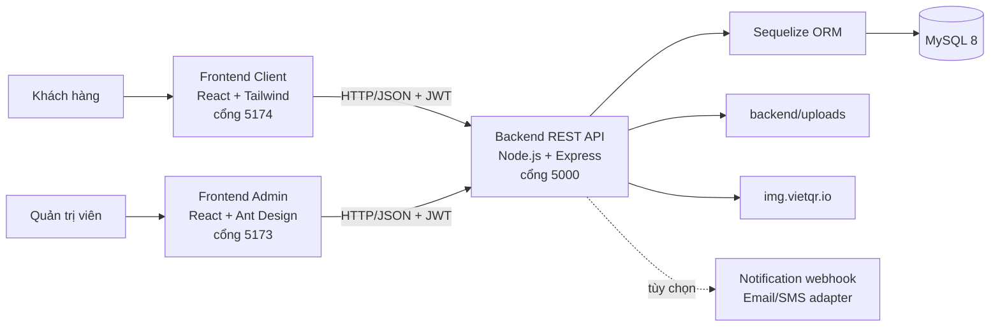
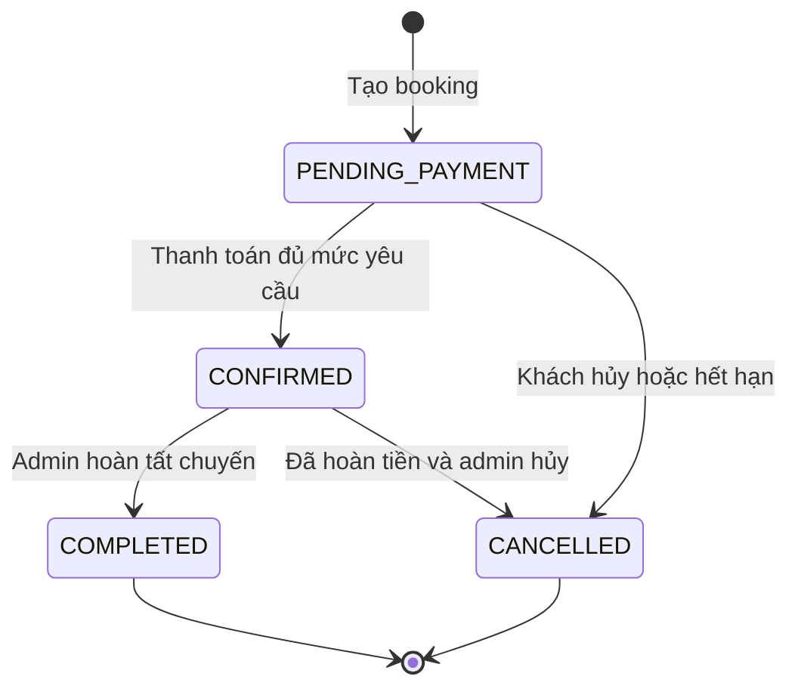

# LeViet Travel

LeViet Travel là hệ thống bán và quản lý tour du lịch gồm ba ứng dụng độc lập:

1. Website dành cho khách hàng để tìm tour, đặt chỗ, thanh toán và quản lý đơn.
2. Trang quản trị dành cho nhân viên vận hành.
3. REST API dùng chung, kết nối hai giao diện với cơ sở dữ liệu MySQL.

Tài liệu này dành cho người mới, kể cả khi chưa quen React, Node.js, REST API hoặc cơ sở dữ liệu.

> Dự án hiện phù hợp cho học tập, đồ án và mô hình một doanh nghiệp tự bán tour. Trước khi dùng trong môi trường kinh doanh thật, hãy đọc phần [Giới hạn hiện tại](#giới-hạn-hiện-tại).

## Mục lục

- [1. Hệ thống làm được gì?](#1-hệ-thống-làm-được-gì)
- [2. Kiến thức cơ bản cần biết](#2-kiến-thức-cơ-bản-cần-biết)
- [3. Kiến trúc tổng thể](#3-kiến-trúc-tổng-thể)
- [4. Công nghệ sử dụng](#4-công-nghệ-sử-dụng)
- [5. Cấu trúc thư mục](#5-cấu-trúc-thư-mục)
- [6. Cài đặt từ đầu trên Windows](#6-cài-đặt-từ-đầu-trên-windows)
- [7. Chạy dự án hằng ngày](#7-chạy-dự-án-hằng-ngày)
- [8. Tài khoản và dữ liệu mẫu](#8-tài-khoản-và-dữ-liệu-mẫu)
- [9. Luồng nghiệp vụ quan trọng](#9-luồng-nghiệp-vụ-quan-trọng)
- [10. Cấu hình môi trường](#10-cấu-hình-môi-trường)
- [11. Tổng quan REST API](#11-tổng-quan-rest-api)
- [12. Cơ sở dữ liệu](#12-cơ-sở-dữ-liệu)
- [13. Kiểm thử và kiểm tra chất lượng](#13-kiểm-thử-và-kiểm-tra-chất-lượng)
- [14. Hướng dẫn phát triển thêm chức năng](#14-hướng-dẫn-phát-triển-thêm-chức-năng)
- [15. Xử lý lỗi thường gặp](#15-xử-lý-lỗi-thường-gặp)
- [16. Build và triển khai](#16-build-và-triển-khai)
- [17. Bảo mật](#17-bảo-mật)
- [18. Giới hạn hiện tại](#18-giới-hạn-hiện-tại)
- [19. Tài liệu chuyên sâu](#19-tài-liệu-chuyên-sâu)

## 1. Hệ thống làm được gì?

### 1.1. Website khách hàng

- Xem voucher đang được admin cấp phép lưu hành.
- Xem danh sách tour, lịch khởi hành, giá và số chỗ còn lại.
- Tìm kiếm, phân trang, lọc và sắp xếp tour theo nhiều tiêu chí.
- Xem chi tiết lịch trình, hình ảnh, video, chính sách và điều kiện của tour.
- Đăng ký, đăng nhập, quên mật khẩu, cập nhật hồ sơ và đổi mật khẩu.
- Xác nhận hoặc thay đổi email, số điện thoại theo luồng bảo mật của hệ thống.
- Lưu tour yêu thích, tour đã xem và so sánh tour.
- Nhận gợi ý tour liên quan.
- Đặt tour cho người lớn, trẻ em, em bé và người cao tuổi.
- Tính phụ thu phòng đơn và áp dụng voucher phía máy chủ.
- Giữ chỗ có thời hạn; hiển thị đồng hồ đếm ngược trước khi hết hạn.
- Thanh toán bằng VietQR, tải ảnh chứng từ thanh toán.
- Xem hóa đơn, lịch sử thanh toán và trạng thái đơn.
- Tự hủy đơn chưa thanh toán hoặc gửi yêu cầu đổi lịch, hủy, hoàn tiền.
- Nhận vé QR để check-in sau khi đơn được xác nhận.
- Đánh giá tour bằng 1–5 sao và bình luận sau khi thanh toán thành công hoặc hoàn thành chuyến đi.

### 1.2. Trang quản trị

- Dashboard doanh thu, số khách hàng, tour, đợt khởi hành và trạng thái booking.
- Quản lý danh mục, tour, ảnh, video và lịch trình từng ngày.
- Quản lý điểm đến, khách sạn, phương tiện, hướng dẫn viên và voucher.
- Mở đợt khởi hành, đặt giá, sức chứa và phân công tài nguyên.
- Quản lý khách hàng, lịch sử đặt tour và khóa/mở tài khoản.
- Booking work queue: lọc đơn, xem hành khách, thanh toán và lịch sử trạng thái.
- Xác nhận, hoàn tất, hủy đơn; ghi chú nội bộ và xử lý yêu cầu hậu mãi.
- Xuất danh sách đoàn, tạo/kiểm tra vé QR và check-in.
- Duyệt hoặc từ chối giao dịch VietQR.
- Import sao kê CSV/XLSX để tự khớp số tiền và nội dung chuyển khoản.
- Ghi nhận hoàn tiền sau khi tiền đã được hoàn ngoài hệ thống.
- Quản lý đánh giá và bình luận: tìm kiếm, lọc, chỉnh sửa hoặc xóa.
- Xuất báo cáo booking dạng Excel.

### 1.3. Backend và tính toàn vẹn dữ liệu

- Xác thực bằng JWT và phân quyền `ADMIN`/`CUSTOMER`.
- Tính giá, voucher và tổng tiền hoàn toàn ở backend.
- Dùng transaction và khóa bản ghi để hạn chế bán vượt số ghế.
- Tự hủy booking quá hạn và hoàn ghế/lượt voucher trong cùng transaction.
- Lưu snapshot giá và chính sách tại thời điểm khách đặt tour.
- Chống xử lý lặp giao dịch sao kê/webhook bằng mã giao dịch duy nhất.
- Chuẩn hóa validation, response lỗi, request ID và phân trang.
- Có migration, seeder và bộ kiểm thử tích hợp với MySQL.

## 2. Kiến thức cơ bản cần biết

Bạn không cần hiểu sâu các khái niệm dưới đây để chạy dự án, nhưng nên biết ý nghĩa của chúng:

| Thuật ngữ | Giải thích ngắn gọn |
|---|---|
| Frontend | Phần giao diện chạy trong trình duyệt. Dự án có một frontend khách hàng và một frontend admin. |
| Backend | Máy chủ nhận yêu cầu, kiểm tra quyền, xử lý nghiệp vụ và truy cập database. |
| REST API | Tập hợp các URL để frontend trao đổi dữ liệu với backend qua HTTP. |
| SPA | Ứng dụng web tải một lần rồi chuyển trang bằng JavaScript mà không tải lại toàn bộ trang. |
| Database | Nơi lưu người dùng, tour, booking, thanh toán, voucher và đánh giá. |
| ORM | Công cụ ánh xạ bảng database thành object JavaScript. Dự án dùng Sequelize. |
| Migration | Mã thay đổi cấu trúc database theo từng phiên bản. |
| Seeder | Mã tạo tài khoản và dữ liệu mẫu để chạy thử. |
| JWT | Chuỗi token chứng minh người dùng đã đăng nhập. Frontend gửi token trong mỗi API cần xác thực. |
| CORS | Quy tắc cho phép các website frontend được gọi tới backend. |
| Transaction | Nhóm thao tác database phải cùng thành công hoặc cùng quay lại trạng thái cũ. |
| VietQR | Mã QR chứa thông tin chuyển khoản; bản thân QR không chứng minh tiền đã vào tài khoản. |

## 3. Kiến trúc tổng thể



Backend là một **modular monolith**: toàn bộ API nằm trong một ứng dụng Node.js nhưng được chia thành các module nghiệp vụ.

Luồng một request backend thường là:

```text
Route → Middleware xác thực/validation → Controller → Service → Sequelize Model → MySQL
```

- `route`: khai báo URL và quyền truy cập.
- `middleware`: kiểm tra JWT, role, dữ liệu đầu vào hoặc file upload.
- `controller`: nhận request và trả response.
- `service`: chứa nghiệp vụ, transaction và truy vấn chính.
- `model`: định nghĩa bảng và quan hệ trong Sequelize.

## 4. Công nghệ sử dụng

### Backend

| Công nghệ | Vai trò |
|---|---|
| Node.js | Runtime chạy JavaScript phía máy chủ. |
| Express 4 | Framework HTTP/REST API. |
| Sequelize 6 | ORM kết nối và truy vấn MySQL. |
| MySQL 8 | Cơ sở dữ liệu quan hệ. |
| JWT + bcrypt | Đăng nhập, token và băm mật khẩu. |
| Multer | Nhận file ảnh/chứng từ upload. |
| ExcelJS | Đọc sao kê và tạo báo cáo Excel. |
| QRCode | Tạo dữ liệu QR check-in. |
| Helmet, CORS, rate limit | Các lớp bảo vệ HTTP cơ bản. |
| Node test runner + Supertest | Unit test và integration test API. |

### Frontend khách hàng

- React 19 và TypeScript 5.9.
- Vite 8.
- React Router 7.
- Tailwind CSS 4.
- Axios.
- Lucide React icons.

### Frontend quản trị

- React 19 và TypeScript 5.9.
- Vite 8.
- React Router 7.
- Ant Design 6.
- Recharts 3.
- Axios và Day.js.

## 5. Cấu trúc thư mục

```text
LeViet_Travel/
├── backend/                         # REST API và database
│   ├── database/schema.sql          # Schema đầy đủ cho database mới; có DROP TABLE
│   ├── docs/                        # Tài liệu API, database, seed, deployment
│   ├── src/
│   │   ├── config/                  # Kết nối DB và kiểm tra môi trường
│   │   ├── constants/               # Các enum/trạng thái dùng chung
│   │   ├── controllers/             # Lớp HTTP mỏng
│   │   ├── database/migrations/     # Các thay đổi schema theo phiên bản
│   │   ├── database/seeders/        # Dữ liệu mẫu
│   │   ├── jobs/                    # Job tự hủy booking quá hạn
│   │   ├── middlewares/             # Auth, validation, upload, error handler
│   │   ├── models/                  # Sequelize models và associations
│   │   ├── routes/                  # Các endpoint /api/*
│   │   ├── services/                # Nghiệp vụ và transaction
│   │   ├── utils/                   # Response, pagination, AppError...
│   │   └── validators/              # Kiểm tra request
│   ├── test/                        # Unit và integration tests
│   ├── uploads/                     # File upload local, không commit lên Git
│   ├── .env.example                 # Mẫu biến môi trường
│   ├── package.json
│   └── server.js                    # Entry point backend
├── frontend-client/                 # Website khách hàng
│   ├── src/components/              # Layout và component dùng chung
│   ├── src/pages/                   # Các trang khách hàng
│   ├── src/UngDung.tsx              # Router
│   ├── src/dich-vu-api.ts           # Axios client và helper API
│   ├── src/types/du-lieu.ts         # Kiểu dữ liệu TypeScript
│   ├── .env.example
│   └── package.json
├── frontend-admin/                  # Cổng quản trị
│   ├── src/api/                     # Axios client admin
│   ├── src/components/              # Layout, catalog và component chung
│   ├── src/hooks/                   # Session và resource phân trang
│   ├── src/pages/                   # Dashboard và các màn hình quản trị
│   ├── src/UngDung.tsx              # Router admin
│   └── package.json
├── .gitignore
└── README.md
```

Repository không dùng npm workspace ở thư mục gốc. Bạn phải cài dependency và chạy lệnh riêng trong từng thư mục `backend`, `frontend-client`, `frontend-admin`.

## 6. Cài đặt từ đầu trên Windows

### 6.1. Phần mềm cần có

- **Node.js:** `20.19.0` trở lên, hoặc `22.12.0` trở lên. Khuyến nghị Node.js 22 LTS.
- **npm:** được cài cùng Node.js.
- **MySQL:** phiên bản 8.0 trở lên.
- **Git:** cần nếu clone source từ Git.
- **VS Code:** không bắt buộc nhưng thuận tiện.

Kiểm tra Node.js và npm:

```powershell
node --version
npm --version
```

Kiểm tra MySQL:

```powershell
mysql --version
```

Nếu lệnh `mysql` không tồn tại, bạn có thể dùng MySQL Workbench hoặc thêm thư mục `bin` của MySQL vào biến `PATH` của Windows.

### 6.2. Cài dependency cho cả ba ứng dụng

Mở PowerShell tại thư mục gốc dự án:

```powershell
cd D:\kienthuc\LeViet_Travel

cd backend
npm ci

cd ..\frontend-client
npm ci

cd ..\frontend-admin
npm ci

cd ..
```

`npm ci` cài đúng phiên bản trong `package-lock.json`. Khi chủ động thêm/xóa package, dùng `npm install` thay vì `npm ci`.

### 6.3. Tạo file cấu hình backend

```powershell
cd backend
Copy-Item .env.example .env
```

Mở `backend/.env` và tối thiểu sửa:

```dotenv
DB_HOST=localhost
DB_PORT=3306
DB_NAME=leviet_travel_db
DB_USER=root
DB_PASSWORD=MAT_KHAU_MYSQL_CUA_BAN
JWT_SECRET=thay_bang_chuoi_ngau_nhien_dai_it_nhat_32_ky_tu
```

Không commit file `.env` lên Git. File này có thể chứa mật khẩu database, JWT secret và thông tin tài khoản nhận tiền.

### 6.4. Khởi tạo database lần đầu

> Cảnh báo: `backend/database/schema.sql` chứa `DROP TABLE`. Chỉ chạy file này với database mới hoặc khi bạn thật sự muốn xóa toàn bộ dữ liệu hiện tại.

Cách dễ nhất cho người mới bằng MySQL Workbench:

1. Mở MySQL Workbench và kết nối máy MySQL local.
2. Chọn **File → Open SQL Script**.
3. Mở `backend/database/schema.sql`.
4. Nhấn biểu tượng tia sét để chạy toàn bộ script.

Hoặc chạy bằng PowerShell từ thư mục `backend`:

```powershell
Get-Content .\database\schema.sql -Raw | mysql -u root -p
```

Sau đó chạy migration và seeder:

```powershell
npm run migrate
npm run seed
```

- `migrate` ghi nhận và áp dụng các thay đổi schema có phiên bản.
- `seed` tạo catalog tour, lịch khởi hành, voucher, booking demo và tài khoản mẫu.
- Seeder có cơ chế cập nhật bản ghi theo khóa ổn định nên có thể chạy lại; tuy nhiên vẫn nên backup database quan trọng trước khi seed.

Nếu database đã có dữ liệu từ phiên bản cũ, **không chạy lại `schema.sql`**. Chỉ backup rồi chạy:

```powershell
npm run migrate
```

### 6.5. Cấu hình frontend

Frontend khách hàng có file mẫu:

```powershell
cd ..\frontend-client
Copy-Item .env.example .env
```

Nội dung mặc định:

```dotenv
VITE_API_BASE_URL=http://localhost:5000/api
```

Frontend admin đã mặc định dùng cùng URL. Nếu cần đổi API, tạo `frontend-admin/.env`:

```dotenv
VITE_API_BASE_URL=http://localhost:5000/api
```

Mọi biến đọc trong Vite và cần xuất hiện ở trình duyệt phải bắt đầu bằng `VITE_`. Không đặt secret trong biến Vite vì người dùng có thể xem được chúng trong bundle frontend.

### 6.6. Khởi động lần đầu

Mở ba terminal riêng.

Terminal 1 — backend:

```powershell
cd D:\kienthuc\LeViet_Travel\backend
npm run dev
```

Terminal 2 — trang admin:

```powershell
cd D:\kienthuc\LeViet_Travel\frontend-admin
npm run dev
```

Terminal 3 — website khách hàng:

```powershell
cd D:\kienthuc\LeViet_Travel\frontend-client
npm run dev
```

Các địa chỉ mặc định:

| Thành phần | URL |
|---|---|
| Website khách hàng | <http://localhost:5174> |
| Trang quản trị | <http://localhost:5173> |
| Backend API | <http://localhost:5000/api> |
| Health check | <http://localhost:5000/api/health> |

Vite có thể chọn cổng khác cho admin nếu `5173` đang bận. Hãy đọc URL thật được in trong terminal.

Kiểm tra backend bằng PowerShell:

```powershell
Invoke-RestMethod http://localhost:5000/api/health
```

## 7. Chạy dự án hằng ngày

Sau lần cài đầu tiên, thông thường chỉ cần mở ba terminal và chạy:

```powershell
# Terminal backend
cd backend
npm run dev

# Terminal admin
cd frontend-admin
npm run dev

# Terminal khách hàng
cd frontend-client
npm run dev
```

Nên dùng `npm run dev` khi lập trình:

- Backend dùng Nodemon và tự khởi động lại khi file JavaScript thay đổi.
- Hai frontend dùng Vite và tự cập nhật giao diện khi file thay đổi.

`npm start` của backend chỉ chạy `node server.js` và **không tự reload**. Nếu dùng lệnh này, bạn phải dừng bằng `Ctrl+C` rồi chạy lại sau mỗi thay đổi backend.

### Các scripts hiện có

Backend:

| Lệnh | Công dụng |
|---|---|
| `npm run dev` | Chạy backend bằng Nodemon. |
| `npm start` | Chạy backend bằng Node.js, phù hợp production/process manager. |
| `npm run migrate` | Áp dụng migration chưa chạy. |
| `npm run seed` | Đồng bộ dữ liệu mẫu. |
| `npm test` | Chạy toàn bộ unit và integration test. |
| `npm run test:unit` | Chỉ chạy unit test. |
| `npm run test:integration` | Chỉ chạy integration test. |

Mỗi frontend:

| Lệnh | Công dụng |
|---|---|
| `npm run dev` | Chạy Vite development server. |
| `npm run lint` | Kiểm tra mã nguồn bằng Oxlint. |
| `npm run typecheck` | Kiểm tra TypeScript, không tạo bundle. |
| `npm run build` | Typecheck và build production vào `dist/`. |
| `npm run preview` | Xem thử bản build production. |

## 8. Tài khoản và dữ liệu mẫu

Sau khi chạy `npm run seed`:

| Vai trò | Email | Mật khẩu |
|---|---|---|
| Admin | `admin@leviet.com` | `Admin@123` |
| Khách hàng | `khachhang@gmail.com` | `Customer@123` |

Seeder còn tạo:

- 6 danh mục.
- 24 điểm đến.
- 4 khách sạn.
- 30 tour có hình ảnh, video và lịch trình.
- Ít nhất 3 đợt khởi hành tương lai cho mỗi tour.
- Voucher `LEVITWELCOME`.
- Các booking và payment demo ở nhiều trạng thái để dashboard có dữ liệu.

Tài khoản và mật khẩu trên chỉ dùng cho local/demo. Hãy thay đổi hoặc xóa chúng trước khi triển khai thật.

## 9. Luồng nghiệp vụ quan trọng

### 9.1. Đặt tour

1. Khách chọn tour và đợt khởi hành còn mở.
2. Khách nhập số lượng từng nhóm hành khách và thông tin người đi.
3. Backend khóa bản ghi đợt khởi hành trong transaction.
4. Backend kiểm tra số ghế, lấy giá hiện tại và tính voucher.
5. Backend lưu booking, hành khách, snapshot giá/chính sách và tăng `bookedSeats`.
6. Booking được tạo với trạng thái `PENDING_PAYMENT` và thời hạn thanh toán.
7. Nếu quá hạn, job nền tự hủy đơn và hoàn ghế/lượt voucher.

Frontend không được quyết định giá cuối cùng. Mọi giá trị tiền đều được backend tính lại để chống sửa request.

### 9.2. Vòng đời booking



| Trạng thái | Ý nghĩa |
|---|---|
| `PENDING_PAYMENT` | Đang giữ chỗ và chờ thanh toán. |
| `CONFIRMED` | Thanh toán/cọc đã được xác nhận, chỗ đã được giữ chính thức. |
| `COMPLETED` | Tour đã hoàn thành. |
| `CANCELLED` | Đơn đã hủy hoặc hết hạn. |

### 9.3. Thanh toán VietQR

1. Backend tạo payment `PENDING` và dữ liệu VietQR theo số tiền/nội dung của booking.
2. Khách chuyển khoản và có thể tải chứng từ.
3. Admin kiểm tra thủ công, import sao kê hoặc nhận webhook ngân hàng đã cấu hình.
4. Khi payment thành `SUCCESS`, booking đủ số tiền cọc/tối thiểu sẽ thành `CONFIRMED`.
5. Nếu từ chối, admin phải nhập lý do và payment thành `FAILED`.
6. Hoàn tiền chỉ được ghi nhận `REFUNDED` sau khi nhân viên đã thực hiện hoàn tiền thật bên ngoài hệ thống.

Trạng thái payment:

```text
PENDING → SUCCESS → REFUNDED
        ↘ FAILED
```

Hiển thị hoặc quét mã VietQR **không đồng nghĩa thanh toán thành công**.

### 9.4. Voucher

- Chỉ voucher `isActive=true`, còn hạn và còn lượt mới xuất hiện công khai.
- Có hai kiểu giảm: `PERCENT` và `FIXED`.
- Backend kiểm tra giá trị đơn tối thiểu, ngày hiệu lực và lượt sử dụng.
- Khi booking hợp lệ được tạo, `usedCount` tăng.
- Khi booking hết hạn/hủy đúng điều kiện, lượt voucher được hoàn trong transaction.
- Hóa đơn lưu rõ tạm tính, số tiền giảm và thành tiền.

### 9.5. Đánh giá

- Mỗi booking chỉ có một đánh giá.
- Rating là số nguyên từ 1 đến 5.
- Khách được đánh giá khi booking đã `COMPLETED`, hoặc booking `CONFIRMED` có payment `SUCCESS`.
- Khách có thể sửa đánh giá của chính mình.
- Admin có thể tìm kiếm, lọc, chỉnh sửa hoặc xóa đánh giá trong trang quản trị.
- Điểm trung bình tour được tính trực tiếp từ các đánh giá còn tồn tại.

### 9.6. Check-in

- Booking `CONFIRMED` hoặc `COMPLETED` có thể nhận vé QR.
- Mỗi booking có một `checkInCode` duy nhất.
- Admin nhập/quét mã tại màn hình Check-in.
- Thời điểm và người check-in được lưu lại.

## 10. Cấu hình môi trường

Nguồn đầy đủ: [`backend/.env.example`](backend/.env.example).

### 10.1. Backend

| Biến | Mặc định/mẫu | Ý nghĩa |
|---|---|---|
| `PORT` | `5000` | Cổng HTTP của backend. |
| `NODE_ENV` | `development` | `development`, `test` hoặc `production`. |
| `TRUST_PROXY` | trống | Chỉ đặt khi backend ở sau reverse proxy tin cậy. |
| `DB_HOST` | `localhost` | Host MySQL. |
| `DB_PORT` | `3306` | Cổng MySQL. |
| `DB_NAME` | `leviet_travel_db` | Tên database. |
| `DB_USER` | `root` | User MySQL; production nên dùng user riêng. |
| `DB_PASSWORD` | — | Mật khẩu MySQL. |
| `DB_POOL_MAX` | `10` | Số connection tối đa trong pool. |
| `DB_POOL_MIN` | `0` | Số connection tối thiểu. |
| `DB_POOL_ACQUIRE_MS` | `30000` | Thời gian chờ lấy connection. |
| `DB_POOL_IDLE_MS` | `10000` | Thời gian connection nhàn rỗi. |
| `JWT_SECRET` | không có giá trị an toàn | Secret ký token, tối thiểu 32 ký tự. |
| `JWT_EXPIRES_IN` | `7d` | Thời gian sống của JWT. |
| `BOOKING_PAYMENT_TTL_MINUTES` | `30` | Số phút giữ ghế chờ thanh toán, tối thiểu 5. |
| `BOOKING_EXPIRY_JOB_INTERVAL_MS` | `60000` | Chu kỳ quét đơn quá hạn, tối thiểu 15 giây. |
| `CLIENT_ADMIN_URL` | `http://localhost:5173` | Origin admin được CORS production cho phép. |
| `CLIENT_CUSTOMER_URL` | `http://localhost:5174` | Origin client được CORS production cho phép. |
| `VIETQR_BANK_ID` | xem file mẫu | Mã BIN/NAPAS của ngân hàng nhận tiền. |
| `VIETQR_BANK_NAME` | xem file mẫu | Tên ngân hàng hiển thị cho khách. |
| `VIETQR_ACCOUNT_NO` | xem file mẫu | Số tài khoản nhận tiền. |
| `VIETQR_ACCOUNT_NAME` | xem file mẫu | Tên chủ tài khoản dạng chuẩn dùng trong QR. |
| `VIETQR_ACCOUNT_DISPLAY_NAME` | xem file mẫu | Tên chủ tài khoản hiển thị trên giao diện. |
| `BANK_WEBHOOK_SECRET` | placeholder | Secret HMAC SHA-256 xác minh webhook giao dịch. |
| `NOTIFICATION_WEBHOOK_URL` | trống | Webhook tùy chọn để gửi email/SMS. |
| `NOTIFICATION_WEBHOOK_SECRET` | trống | Secret ký request gửi tới notification webhook. |

Backend yêu cầu ít nhất `DB_HOST`, `DB_NAME`, `DB_USER` và `JWT_SECRET`. Khi `NODE_ENV=production`, phải khai báo ít nhất một URL frontend cho CORS.

### 10.2. Frontend

| Biến | Mặc định | Ý nghĩa |
|---|---|---|
| `VITE_API_BASE_URL` | `http://localhost:5000/api` | Base URL của backend API. |

Sau khi thay đổi file `.env`, hãy khởi động lại ứng dụng tương ứng.

### 10.3. Email, SMS và mã xác thực khi phát triển

Hệ thống không kết nối trực tiếp Gmail hoặc nhà mạng. Nó hỗ trợ một notification webhook tùy chọn.

- Nếu chưa cấu hình `NOTIFICATION_WEBHOOK_URL`, backend không gửi ra ngoài.
- Trong môi trường không phải production, API trả thêm `developmentToken` để bạn thử quên mật khẩu/xác thực.
- Trong production, mã không được trả về client; bạn phải cấu hình nhà cung cấp thông báo thật.

## 11. Tổng quan REST API

Base URL local:

```text
http://localhost:5000/api
```

### 11.1. Xác thực

API cần đăng nhập sử dụng header:

```http
Authorization: Bearer <access_token>
Content-Type: application/json
```

JWT được frontend lưu trong `localStorage` và Axios tự gắn vào request.

### 11.2. Response chuẩn

Thành công:

```json
{
  "success": true,
  "message": "Thao tác thành công",
  "data": {}
}
```

Thất bại:

```json
{
  "success": false,
  "message": "Dữ liệu không hợp lệ",
  "errors": [
    { "field": "email", "message": "Email không hợp lệ" }
  ]
}
```

Mỗi response có header `X-Request-Id` để tra cứu log.

### 11.3. Phân trang

Các API danh sách thường nhận:

```text
?page=1&limit=10
```

`limit` tối đa là 100. Dữ liệu trả về:

```json
{
  "items": [],
  "pagination": {
    "page": 1,
    "limit": 10,
    "totalItems": 0,
    "totalPages": 0
  }
}
```

### 11.4. Các nhóm endpoint

| Nhóm | Endpoint tiêu biểu | Quyền |
|---|---|---|
| Health | `GET /health` | Public |
| Auth | `POST /auth/register`, `POST /auth/login`, `GET /auth/me` | Public/đã đăng nhập |
| Hồ sơ | `PUT /auth/profile`, `PUT /auth/contact` | Đã đăng nhập |
| Mật khẩu/xác thực | `/auth/forgot-password`, `/auth/reset-password`, `/auth/verification/*` | Tùy endpoint |
| Danh mục | `/categories` | Xem public, thay đổi bởi admin |
| Điểm đến | `/destinations` | Xem public, thay đổi bởi admin |
| Tour | `/tours`, `/tours/:id/recommendations` | Xem public, thay đổi bởi admin |
| Lịch trình | `/tours/:tourId/itineraries` | Xem public, thay đổi bởi admin |
| Khởi hành | `/departures` | Xem public, thay đổi bởi admin |
| Voucher | `GET /vouchers/public`, `POST /vouchers/validate` | Public/đã đăng nhập; CRUD admin |
| Booking | `/bookings`, `/bookings/:id/change-requests`, `/bookings/check-in` | Đã đăng nhập; một số thao tác admin |
| Payment | `/payments`, `/payments/reconciliation/import`, `/payments/webhooks/bank` | Đã đăng nhập/admin/webhook |
| Review | `/reviews/tour/:tourId`, `/reviews` | Xem public; tạo bởi khách; danh sách quản trị bởi admin |
| Người dùng | `/users` | Admin |
| Dashboard | `/dashboard/summary`, `/dashboard/analytics` | Admin |
| Báo cáo | `/reports/bookings.xlsx`, `/reports/departures/:id/manifest.xlsx` | Admin |

Mã trạng thái HTTP thường gặp:

| Mã | Ý nghĩa |
|---|---|
| `200` | Thành công. |
| `201` | Tạo dữ liệu thành công. |
| `400` | Request sai cú pháp. |
| `401` | Chưa đăng nhập/token sai hoặc hết hạn. |
| `403` | Đã đăng nhập nhưng không đủ quyền. |
| `404` | Không tìm thấy endpoint hoặc dữ liệu. |
| `409` | Xung đột nghiệp vụ, ví dụ đánh giá trùng. |
| `422` | Dữ liệu đầu vào không hợp lệ. |
| `429` | Gửi request quá nhiều. |
| `500` | Lỗi nội bộ backend; dùng `X-Request-Id` để tìm log. |

## 12. Cơ sở dữ liệu

### 12.1. Các nhóm bảng

| Nhóm | Bảng chính | Công dụng |
|---|---|---|
| Tài khoản | `users`, `user_verification_tokens` | User, role, hồ sơ và token xác thực. |
| Catalog | `categories`, `destinations`, `tours`, `tour_destinations`, `tour_itineraries` | Nội dung tour và lịch trình. |
| Điều phối | `hotels`, `vehicles`, `tour_guides`, `tour_departures` | Tài nguyên và lịch khởi hành. |
| Bán hàng | `vouchers`, `bookings`, `booking_participants` | Voucher, đơn và hành khách. |
| Thanh toán | `payments`, `payment_reconciliation_events` | Giao dịch và chống đối soát lặp. |
| Hậu mãi | `booking_change_requests`, `reviews` | Yêu cầu thay đổi và đánh giá. |
| Theo dõi | `booking_activities`, `schema_migrations` | Timeline booking và lịch sử migration. |

### 12.2. Quan hệ quan trọng

- Một category có nhiều tour.
- Tour và destination có quan hệ nhiều-nhiều qua `tour_destinations`.
- Một tour có nhiều itinerary, departure và review.
- Một departure thuộc một tour và có thể gắn hotel, vehicle, guide.
- Một user có nhiều booking.
- Một booking có nhiều participant và payment nhưng chỉ có tối đa một review.
- Voucher có thể được nhiều booking sử dụng trong giới hạn cho phép.

### 12.3. Quy ước dữ liệu

- JavaScript/TypeScript dùng `camelCase`, ví dụ `bookingCode`.
- Cột MySQL dùng `snake_case`, ví dụ `booking_code`.
- Một số catalog sử dụng soft delete qua `deleted_at`.
- Tiền được lưu dạng `DECIMAL`, không tin giá trị do frontend gửi.
- Thời gian database được cấu hình theo múi giờ `+07:00`.

### 12.4. Schema và migration khác nhau thế nào?

- `database/schema.sql`: ảnh chụp đầy đủ cấu trúc mới nhất, dùng để tạo/reset database từ đầu.
- `src/database/migrations/`: các bước nâng database cũ lên phiên bản mới mà không xóa toàn bộ dữ liệu.
- `schema_migrations`: bảng ghi migration nào đã chạy.

Mỗi khi thay đổi schema, cần cập nhật cả model, migration và `database/schema.sql`.

## 13. Kiểm thử và kiểm tra chất lượng

### 13.1. Backend

> Integration test dùng database được khai báo trong `backend/.env`. Không bao giờ trỏ test vào database production.

```powershell
cd backend
npm test
```

Bộ test hiện kiểm tra các nhóm chính:

- Health check, request ID và response lỗi.
- Đăng ký, đăng nhập, mật khẩu và phân quyền.
- Catalog, tour, itinerary và departure.
- Tính giá booking và voucher phía server.
- Thanh toán, từ chối, hoàn tiền và đối soát chống lặp.
- Hết hạn booking và hoàn ghế/voucher.
- Đánh giá của khách và quản lý đánh giá của admin.
- Dashboard và file Excel.
- Seeder và payload VietQR.

### 13.2. Frontend khách hàng

```powershell
cd frontend-client
npm run lint
npm run typecheck
npm run build
```

### 13.3. Frontend admin

```powershell
cd frontend-admin
npm run lint
npm run typecheck
npm run build
```

Hiện chưa có component test hoặc browser E2E tự động cho hai frontend. Khi phát triển luồng quan trọng, nên kiểm thử tay cả vai trò khách hàng và admin.

## 14. Hướng dẫn phát triển thêm chức năng

### 14.1. Thêm một API resource mới

Thứ tự khuyến nghị:

1. Tạo/cập nhật model trong `backend/src/models/`.
2. Khai báo association trong `backend/src/models/index.js`.
3. Tạo migration và cập nhật `backend/database/schema.sql`.
4. Tạo validator trong `backend/src/validators/`.
5. Viết nghiệp vụ trong `backend/src/services/`.
6. Tạo controller trong `backend/src/controllers/`.
7. Tạo route và gắn middleware quyền trong `backend/src/routes/`.
8. Mount route trong `backend/src/app.js` nếu là nhóm route mới.
9. Thêm integration test.
10. Cập nhật kiểu dữ liệu và giao diện frontend.

Đừng đặt nghiệp vụ phức tạp trong controller hoặc frontend. Các quy tắc giá, ghế, voucher và quyền sở hữu phải nằm ở backend.

### 14.2. Thêm trang khách hàng

1. Tạo file trong `frontend-client/src/pages/`.
2. Thêm kiểu DTO vào `frontend-client/src/types/du-lieu.ts` nếu cần.
3. Dùng Axios wrapper trong `dich-vu-api.ts`.
4. Lazy import và thêm route trong `frontend-client/src/UngDung.tsx`.
5. Thêm liên kết menu trong `frontend-client/src/components/BoCuc.tsx` nếu cần.

### 14.3. Thêm trang admin

1. Tạo file trong `frontend-admin/src/pages/`.
2. Thêm type vào `frontend-admin/src/types/du-lieu.ts`.
3. Dùng `usePagedResource` cho danh sách phân trang nếu phù hợp.
4. Lazy import và thêm route trong `frontend-admin/src/UngDung.tsx`.
5. Thêm mục menu trong `frontend-admin/src/components/layout/BoCucQuanTri.tsx`.

### 14.4. Quy ước nên giữ

- Backend dùng CommonJS (`require`, `module.exports`).
- Hai frontend dùng TypeScript và React function component.
- File/symbol frontend chủ yếu dùng tiếng Việt không dấu; nội dung giao diện dùng tiếng Việt có dấu.
- API trả envelope thống nhất qua `ApiResponse`.
- Lỗi nghiệp vụ dùng `AppError` với HTTP status phù hợp.
- Validator trả danh sách `{ field, message }`.
- Nghiệp vụ cạnh tranh tài nguyên dùng transaction và row lock.
- Không đưa password, token, secret hoặc `.env` vào Git.

## 15. Xử lý lỗi thường gặp

### 15.1. `Port 5174 is already in use`

Một Vite server khác đang dùng cổng client.

Tìm PID:

```powershell
Get-NetTCPConnection -LocalPort 5174 -State Listen | Select-Object OwningProcess
```

Xem tiến trình:

```powershell
Get-Process -Id <PID>
```

Nếu đúng là tiến trình cũ của dự án, dừng terminal cũ bằng `Ctrl+C` hoặc:

```powershell
Stop-Process -Id <PID>
```

Không mở nhiều server cùng ứng dụng nếu không cần thiết.

### 15.2. API mới vẫn trả `404`

Nguyên nhân phổ biến là backend đang chạy bằng `npm start`, nên tiến trình cũ chưa nạp route mới.

1. Dừng backend bằng `Ctrl+C`.
2. Chạy lại bằng `npm run dev`.
3. Tải lại trang frontend.

Kiểm tra backend nào đang dùng cổng 5000:

```powershell
Get-NetTCPConnection -LocalPort 5000 -State Listen
```

### 15.3. Terminal in nhiều dòng `Executing (default): SELECT ...`

Đây thường không phải lỗi. Khi `NODE_ENV=development`, Sequelize in câu SQL để hỗ trợ debug.

Chỉ cần xử lý nếu sau đó có dòng lỗi như `SequelizeDatabaseError`, `Access denied`, `Unknown column` hoặc response HTTP `500`.

Muốn giảm log SQL, chạy với môi trường không phải `development`, nhưng không nên dùng `production` giả trong lúc cấu hình local nếu chưa hiểu CORS và các yêu cầu bảo mật.

### 15.4. `Access denied for user`

- Kiểm tra `DB_USER` và `DB_PASSWORD` trong `backend/.env`.
- Thử đăng nhập trực tiếp: `mysql -u <user> -p`.
- Kiểm tra user có quyền trên `leviet_travel_db`.
- Khởi động lại backend sau khi sửa `.env`.

### 15.5. `Unknown database 'leviet_travel_db'`

Bạn chưa import schema hoặc tên database trong `.env` không khớp. Hãy làm lại bước [Khởi tạo database lần đầu](#64-khởi-tạo-database-lần-đầu).

### 15.6. Trang admin/client không gọi được API

Kiểm tra theo thứ tự:

1. <http://localhost:5000/api/health> có trả dữ liệu không.
2. `VITE_API_BASE_URL` có kết thúc bằng `/api` không.
3. Backend có chạy đúng cổng không.
4. Trong production, `CLIENT_ADMIN_URL` và `CLIENT_CUSTOMER_URL` có đúng origin không.
5. Mở DevTools → Network để xem status `401`, `403`, `404`, `422` hay `500`.

### 15.7. `401 Unauthorized`

- Đăng nhập lại vì token có thể hết hạn.
- Kiểm tra tài khoản chưa bị khóa.
- Xóa session cũ trong `localStorage` nếu vừa đổi `JWT_SECRET`.
- `401` khác `403`: `401` là token không hợp lệ; `403` là đã đăng nhập nhưng thiếu quyền.

### 15.8. Chữ tiếng Việt bị lỗi kiểu `Ä‘`, `á»`

- Đảm bảo file được lưu bằng UTF-8.
- Trong VS Code, nhấn encoding ở góc phải dưới → **Save with Encoding → UTF-8**.
- MySQL phải dùng `utf8mb4` và collation `utf8mb4_unicode_ci`.
- Nếu chỉ terminal hiển thị sai nhưng trình duyệt đúng, vấn đề có thể nằm ở encoding của terminal chứ không phải file.

### 15.9. Voucher không xuất hiện ở trang chủ

Kiểm tra voucher:

- `isActive=true`.
- Ngày hiện tại nằm giữa `startDate` và `endDate`.
- `usedCount < maxUsage`.
- Backend đã được restart sau khi cập nhật API.

### 15.10. Đơn thanh toán thành công nhưng chưa đánh giá được

- Payment phải có trạng thái `SUCCESS`.
- Booking phải là `CONFIRMED` hoặc `COMPLETED`.
- Mỗi booking chỉ được đánh giá một lần; nếu đã có, dùng chức năng chỉnh sửa.
- Restart backend nếu vừa cập nhật mã nguồn.

## 16. Build và triển khai

### 16.1. Build hai frontend

```powershell
cd frontend-client
npm ci
npm run build

cd ..\frontend-admin
npm ci
npm run build
```

Mỗi bản build nằm trong thư mục `dist/` của ứng dụng tương ứng. Có thể phục vụ bằng Nginx, IIS, Apache hoặc nền tảng static hosting. Vì dùng SPA routing, web server cần fallback các URL không phải file về `index.html`.

### 16.2. Backend production

Quy trình tối thiểu:

```powershell
cd backend
npm ci --omit=dev
npm run migrate
npm start
```

Trước production:

1. Backup database.
2. Dùng user MySQL riêng, không dùng `root`.
3. Đặt `NODE_ENV=production`.
4. Tạo `JWT_SECRET` và `BANK_WEBHOOK_SECRET` đủ mạnh.
5. Cấu hình đúng HTTPS origin cho CORS.
6. Kiểm tra tài khoản VietQR thật.
7. Dùng HTTPS và reverse proxy.
8. Gắn persistent volume cho `backend/uploads` hoặc chuyển sang object storage.
9. Không tự động chạy seeder ở mỗi lần deploy.
10. Kiểm tra health, login, booking, payment và download Excel sau deploy.

Repository hiện không có Dockerfile, Docker Compose hoặc CI/CD workflow. Xem hướng dẫn chi tiết tại [`backend/docs/DEPLOYMENT.md`](backend/docs/DEPLOYMENT.md).

## 17. Bảo mật

- Không commit `.env`, database dump, JWT, webhook secret hoặc log chứa token.
- Mật khẩu được băm bằng bcrypt; API không được trả password hash.
- Đổi ngay tài khoản demo khi triển khai thật.
- JWT hiện được lưu ở `localStorage`; cần kiểm soát XSS nghiêm ngặt.
- File upload chỉ chấp nhận loại ảnh được cấu hình và giới hạn kích thước.
- Webhook ngân hàng dùng chữ ký HMAC SHA-256 và lưu sự kiện để chống replay.
- Không tin giá, giảm giá, quyền sở hữu booking hoặc trạng thái payment do frontend gửi.
- Thao tác hoàn tiền trong hệ thống là ghi nhận nghiệp vụ, không thay thế giao dịch hoàn tiền tại ngân hàng.
- Chạy `npm audit` định kỳ nhưng không dùng `npm audit fix --force` mà chưa đánh giá breaking change.
- Test phải sử dụng database riêng, không dùng production.

## 18. Giới hạn hiện tại

- VietQR tạo thông tin chuyển khoản nhưng không phải cổng thanh toán thẻ/ví điện tử hoàn chỉnh.
- Webhook ngân hàng chỉ hoạt động khi đơn vị triển khai có nguồn giao dịch thật và cấu hình secret tương ứng.
- Email/SMS đi qua notification webhook tùy chọn; repository không tích hợp trực tiếp Gmail, Twilio hoặc Zalo.
- Upload đang lưu trên ổ đĩa local, chưa phù hợp nhiều backend instance nếu không dùng volume chung.
- Không có Docker/Compose, CI/CD, monitoring tập trung, Sentry hoặc APM trong repository.
- Chưa có automated test cho component frontend, browser E2E, accessibility hoặc visual regression.
- JWT chưa có refresh token và cơ chế thu hồi theo thiết bị.
- Search chủ yếu dùng SQL `LIKE`, chưa có search engine/full-text chuyên dụng.
- Frontend là SPA, chưa có SSR/SSG và SEO động đầy đủ cho từng tour.
- Hệ thống là single-operator, chưa hỗ trợ marketplace nhiều nhà cung cấp/tenant.

## 19. Tài liệu chuyên sâu

- [REST API](backend/docs/API.md)
- [Database và migration](backend/docs/DATABASE.md)
- [Dữ liệu mẫu và nguồn nội dung](backend/docs/SEED_DATA.md)
- [Cài đặt và triển khai backend](backend/docs/DEPLOYMENT.md)

Khi tài liệu và mã nguồn khác nhau, mã nguồn, migration và test hiện tại là nguồn đáng tin cậy hơn. Nếu thay đổi nghiệp vụ hoặc endpoint, hãy cập nhật README và tài liệu liên quan trong cùng pull request.

---

Nếu bạn mới bắt đầu, thứ tự học và thử phù hợp nhất là:

1. Chạy được `/api/health`.
2. Đăng nhập website khách hàng bằng tài khoản mẫu.
3. Chọn tour và tạo một booking.
4. Mở admin để duyệt payment.
5. Quay lại trang khách để xem đơn, vé QR và đánh giá.
6. Đọc `bookingService.js` và `paymentService.js` để hiểu nghiệp vụ transaction.
7. Chạy test trước và sau mỗi thay đổi lớn.
